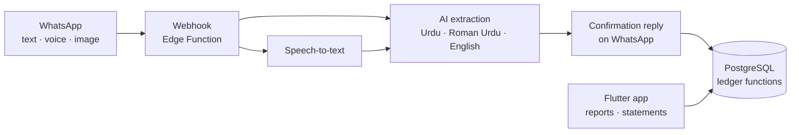

# KhataBol

[](https://github.com/hashamkhan11/khatabol/actions/workflows/ci.yml)

**Speak your khata.** A bookkeeping system for small traders in Pakistan that
takes entries the way they already work: WhatsApp messages, Urdu voice notes
and forwarded screenshots.

## The problem

Wholesale traders, such as cloth and textile dealers, run most of their business
on credit (*udhaar*) and on WhatsApp. Deals, rates and payments get agreed in chats
and voice notes. Ledger apps expect someone to sit down and type all of it into
forms. That rarely happens, so the paper khata and the trader's memory stay the
real record.

KhataBol gives the trader a WhatsApp number to talk to instead:

> *"Rashid se 500 kg purana kapra 120 ke rate pe liya, 20 hazar cash diye"*
> (Bought 500 kg of used cloth from Rashid at 120 a kg, paid 20,000 cash)

The bot reads the message, replies with what it understood, and records the deal
once the trader confirms. Rashid's khata then shows that the trader owes him 40,000.

## Architecture



The database is the core. All business rules live in PostgreSQL functions, so
the WhatsApp bot and the mobile app can never disagree about a balance.

## Design decisions

| Decision | Why |
|---|---|
| **PostgreSQL (Supabase), not a document store** | A ledger needs transactions, joins and sums over money. SQL does this natively and correctly. |
| **Balances are never stored** | A balance is `SUM(amount)` over a party's khata lines, so it can never drift out of sync. |
| **Records are append-only** | Nothing is edited or deleted. A mistake is cancelled with reversing lines, which keeps a full audit trail. Triggers enforce this. |
| **Clients can only read** | Row-level security gives each user read access to their own rows. Every write goes through `SECURITY DEFINER` functions that validate input. |
| **Exact money** | Amounts use `numeric`, never floating point. Weight is always kg. |
| **Real profit** | Profit = sales − average cost of the goods sold + commission − costs. Unsold stock is not counted as a loss. Stock uses moving weighted average cost. |
| **Every source is tracked** | Each entry records whether it came from the app, WhatsApp or the system, plus a reference to the original message. |

The data model covers:

- **Deals:** purchase, sale and brokerage (commission). Commission can be per kg,
  a percentage or a fixed amount, charged to the seller, the buyer or both. On a
  brokerage deal, the goods money can pass through the broker's khata or go
  directly from buyer to seller.
- **Deal costs:** freight, labour and similar. Each cost can be charged to a party
  and owed to a transporter on credit.
- **Payments, expenses and opening balances.**
- **Stock:** adjustments for opening stock and wastage.
- **Reports:** party statements, stock valuation and a profit report.

## Roadmap

- [x] **1. Ledger database:** schema, business functions and a test suite
- [ ] **2. Mobile app:** Flutter screens on Supabase, with phone OTP login
- [ ] **3. WhatsApp bot (text):** Urdu, Roman Urdu and English messages, with confirmation before saving
- [ ] **4. Voice notes and screenshots**
- [ ] **5. Queries and summaries:** "Rashid ka balance?", statements and a daily summary

## Repository layout

```
supabase/
  migrations/   schema and ledger functions (deployed to Supabase)
  tests/        tests on an in-memory Postgres (PGlite)
```

`app/` (Flutter) and `bot/` (WhatsApp webhook) will be added as the roadmap
progresses.

## Running the tests

The tests run on [PGlite](https://pglite.dev), a full PostgreSQL compiled to
WebAssembly, so you need neither Docker nor a database server.
Requires Node.js 22+.

```
cd supabase
npm ci
npm test
```

See [supabase/README.md](supabase/README.md) for the list of functions.

## License

[MIT](LICENSE)
