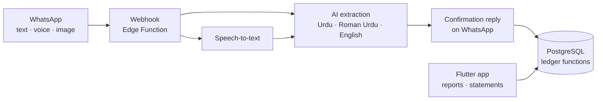

# KhataBol

[](https://github.com/hashamkhan11/khatabol/actions/workflows/ci.yml)

**Speak your khata.** A bookkeeping system for small traders in Pakistan that
takes entries the way they already work: WhatsApp messages, Urdu voice notes
and forwarded screenshots.

## The problem

Wholesale traders, such as cloth and textile dealers, run most of their business
on credit (*udhaar*) and on WhatsApp. Deals, rates and payments get agreed in chats
and voice notes. Ledger apps expect someone to sit down and type all of it into
forms. That rarely happens, so the paper khata and the trader's memory stay the
real record.

KhataBol gives the trader a WhatsApp number to talk to instead:

> *"Rashid se 500 kg purana kapra 120 ke rate pe liya, 20 hazar cash diye"*
> (Bought 500 kg of used cloth from Rashid at 120 a kg, paid 20,000 cash)

The bot reads the message, replies with what it understood, and records the deal
once the trader confirms. Rashid's khata then shows that the trader owes him 40,000.

## Product principles

These shape every screen and every database function.

1. **Talk in, look up.** Most entries will come from WhatsApp as natural
   language (Roman Urdu, Urdu or English, typed or spoken). The app is mainly
   for *looking*: it opens on a dashboard (*Khulasa*) with totals owed both
   ways, this month's profit, stock in hand, the biggest balances and the
   latest activity. Every entry can still be made by hand in the app.
2. **One structured call per action.** Every write is a single database function
   with typed parameters: `record_deal`, `record_payment`, `record_expense`,
   `record_stock_adjustment`, `reverse_entry`. That is exactly what an AI
   extractor fills in. The bot and the app call the same functions with the same
   validation, so there is no second, "bot-only" path to keep in sync.
3. **Choices are closed lists.** Wherever the user picks a reason or type (party
   type, payment method, commission mode, why stock changed), the database
   stores an enum, not free text. A model maps "maal kharab ho gaya" to
   `wastage` reliably; it cannot do that against free text that drifts.
4. **Store facts, not sentences.** Ledger lines store the entry kind and links to
   the deal, cloth type, kg, rate and other party. The `note` column holds only
   what the user typed. Each client words the line itself: the app in Roman
   Urdu, the bot in whatever language it was spoken to. Changing wording never
   needs a data migration.
5. **Roman Urdu on screen.** Labels follow how traders already talk: *Lena hai*
   (they owe you), *Dena hai* (you owe them), *Sauday* (deals), *Kharchay*
   (expenses), *Munafa* (profit). Business words people say in English, like
   stock, rate and cash, stay in English.
6. **Confirm, then save; never edit.** The bot will read back what it understood
   before saving. A mistake is cancelled with a reversing line, so the khata
   always shows what happened and when.

## Architecture



The database is the core. All business rules live in PostgreSQL functions, so
the WhatsApp bot and the mobile app can never disagree about a balance.

## Design decisions

| Decision | Why |
|---|---|
| **PostgreSQL (Supabase), not a document store** | A ledger needs transactions, joins and sums over money. SQL does this natively and correctly. |
| **Balances are never stored** | A balance is `SUM(amount)` over a party's khata lines, so it can never drift out of sync. |
| **Records are append-only** | Nothing is edited or deleted. A mistake is cancelled with reversing lines, which keeps a full audit trail. Triggers enforce this. |
| **Clients can only read** | Row-level security gives each user read access to their own rows. Every write goes through `SECURITY DEFINER` functions that validate input. |
| **Exact money** | Amounts use `numeric`, never floating point. Weight is always kg. |
| **Real profit** | Profit = sales − average cost of the goods sold + commission − costs. Unsold stock is not counted as a loss. Stock uses moving weighted average cost. |
| **Every source is tracked** | Each entry records whether it came from the app, WhatsApp or the system, plus a reference to the original message. |

The data model covers:

- **Deals:** purchase, sale and brokerage (commission). Commission can be per kg,
  a percentage or a fixed amount, charged to the seller, the buyer or both. On a
  brokerage deal, the goods money can pass through the broker's khata or go
  directly from buyer to seller.
- **Deal costs:** freight, labour and similar. Each cost can be charged to a party
  and owed to a transporter on credit.
- **Payments, expenses and opening balances.**
- **Stock:** each cloth type has a stock register: every purchase, sale and
  adjustment with kg in hand after it. Changes outside a deal are recorded as
  *stock in* (opening stock, found in a count, other) or *stock out* (wastage,
  short in a count, own use, sample, other). Stock in carries a cost per kg;
  stock out is valued at the current average cost and counted as a stock loss
  in the profit report.
- **Reports:** party statements, stock valuation and register, a profit report
  and a dashboard summary.

## Roadmap

- [x] **1. Ledger database:** schema, business functions and a test suite
- [x] **2. Mobile app:** Flutter app on Supabase: dashboard, khata, deals, stock register, expenses and profit, all in Roman Urdu
- [x] **3. WhatsApp bot (text):** Urdu, Roman Urdu and English messages, read back for a yes before saving, with undo
- [x] **4. Voice notes and photos:** Urdu voice notes, parchis, bills and payment screenshots, with a token log to track cost
- [ ] **5. Queries and summaries:** "Rashid ka balance?", statements and a daily summary

## Repository layout

```
supabase/
  migrations/   schema and ledger functions (deployed to Supabase)
  tests/        tests on an in-memory Postgres (PGlite)
  functions/whatsapp/   the WhatsApp bot (Edge Function, TypeScript)
app/
  lib/data/     models and the repository that calls the ledger functions
  lib/l10n/     Roman Urdu wording of khata lines
  lib/screens/  dashboard, khata, deals, stock, expenses and profit screens
  test/         unit tests for the deal preview, parsing and wording
```

See [supabase/functions/whatsapp/README.md](supabase/functions/whatsapp/README.md)
for how the bot works and how to connect it to WhatsApp.

## Running the tests

The tests run on [PGlite](https://pglite.dev), a full PostgreSQL compiled to
WebAssembly, so you need neither Docker nor a database server.
Requires Node.js 22+.

```
cd supabase
npm ci
npm test
```

See [supabase/README.md](supabase/README.md) for the list of functions.

App tests (Flutter 3.38+):

```
cd app
flutter test
```

See [app/README.md](app/README.md) to run the app.

## License

[MIT](LICENSE)
