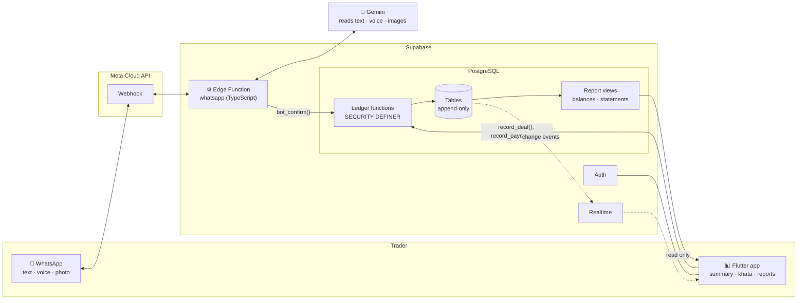
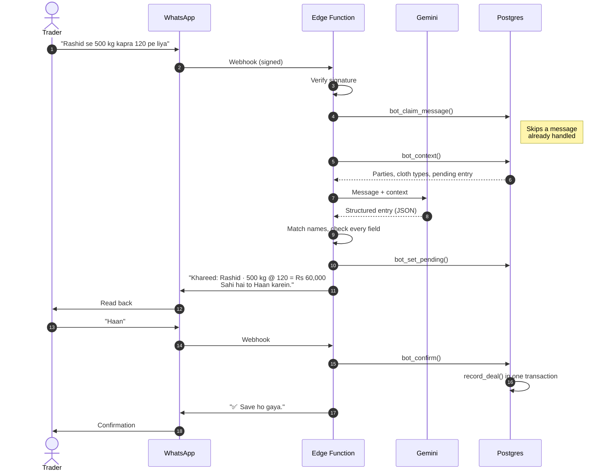
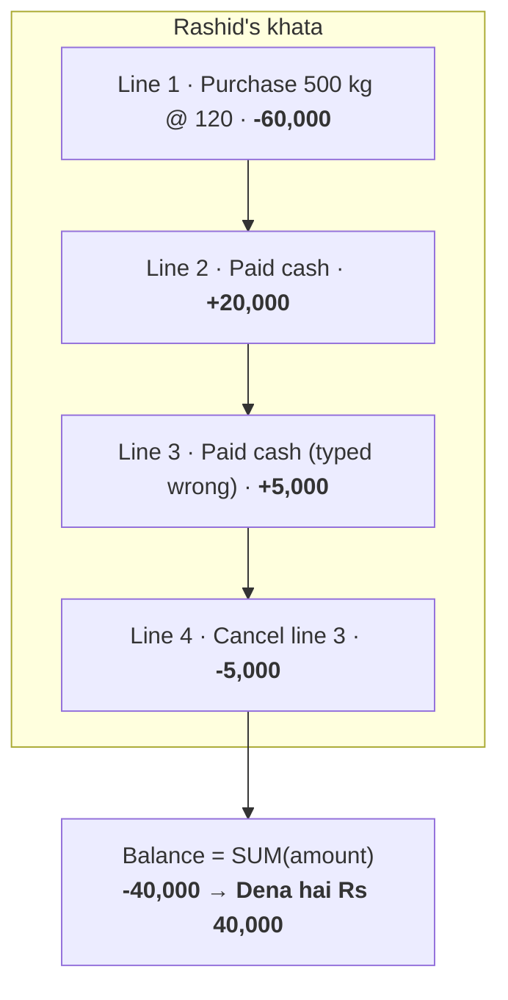
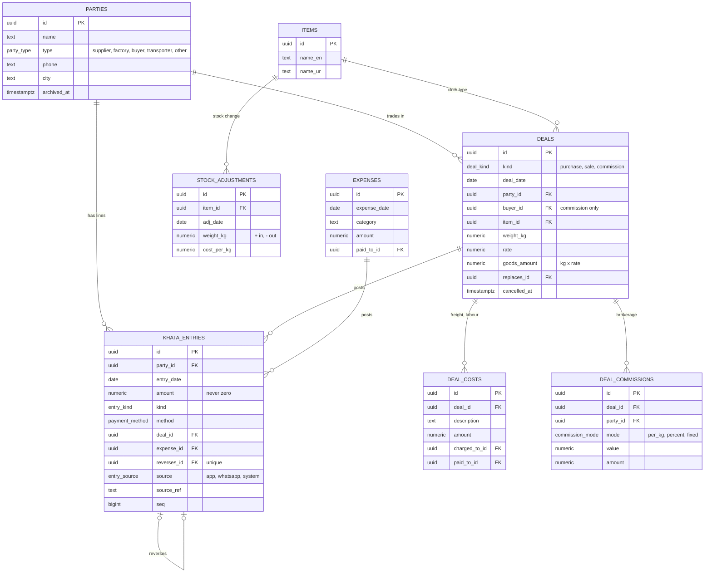
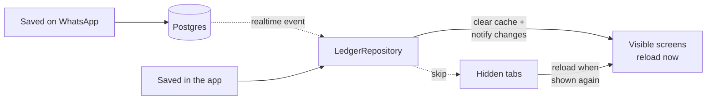
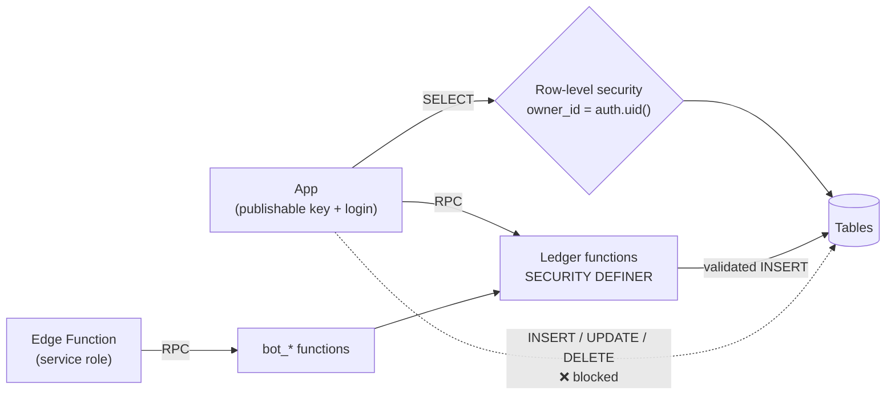
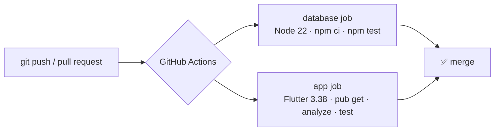

# KhataBol

[](https://github.com/hashamkhan11/khatabol/actions/workflows/ci.yml)


**Speak your khata.** KhataBol is a bookkeeping system for small wholesale traders
in Pakistan. It takes entries the way traders already work: WhatsApp messages,
Urdu voice notes and forwarded payment screenshots. A mobile app shows who owes
what, stock in hand and real profit.

> *"Rashid se 500 kg purana kapra 120 ke rate pe liya, 20 hazar cash diye"*
> (Bought 500 kg of used cloth from Rashid at 120 a kg, paid 20,000 cash)
>
> The bot replies with what it understood. The trader says **"Haan"**, and the deal
> is saved. Rashid's khata now shows the trader owes him **Rs 40,000**.

---

## Contents

- [The problem](#the-problem)
- [Features](#features)
- [How it works](#how-it-works)
- [The WhatsApp bot](#the-whatsapp-bot)
- [The ledger](#the-ledger)
- [Data model](#data-model)
- [The mobile app](#the-mobile-app)
- [Security model](#security-model)
- [Design decisions](#design-decisions)
- [Tech stack](#tech-stack)
- [Repository layout](#repository-layout)
- [Getting started](#getting-started)
- [Testing and CI](#testing-and-ci)
- [Roadmap](#roadmap)
- [License](#license)

---

## The problem

Wholesale traders, such as cloth and textile dealers, run most of their business
on credit (*udhaar*) and on WhatsApp. Deals, rates and payments are agreed in
chats and voice notes. Ledger apps expect someone to sit down and type all of it
into forms. That rarely happens, so the paper khata and the trader's memory stay
the real record, and mistakes are only found when two people disagree about a
balance.

KhataBol removes the typing. The trader sends a message to a WhatsApp number in
the language they already use, checks the reply, and says yes. The books stay
correct without anyone filling in a form.

## Features

| | |
|---|---|
| 💬 **WhatsApp entry** | Deals, payments, expenses and stock changes in Roman Urdu, Urdu or English. |
| 🎤 **Voice notes** | Speak in Urdu, Punjabi or English. The bot shows what it heard before anything is saved. |
| 📷 **Photos** | Send a handwritten *parchi*, a bill, or a JazzCash / Easypaisa screenshot. |
| ✅ **Read back, then save** | Nothing is saved until the trader replies "Haan". An entry can be corrected before saving, or undone after. |
| 📒 **Party khatas** | Every supplier, factory, buyer and transporter has a running statement with *Lena hai* (to receive) and *Dena hai* (to pay). |
| 🤝 **Three deal types** | Purchase, sale, and brokerage with commission per kg, by percent or as a fixed amount. Freight and labour costs can be charged to any party. |
| 📦 **Stock register** | Kg in hand and value for each cloth type, with wastage, count differences, samples and own use. |
| 📈 **Real profit** | Sales minus the average cost of what was sold, plus commission, minus costs and expenses. |
| 🔄 **Live updates** | An entry saved on WhatsApp appears in the open app straight away. |
| 🌐 **Two languages** | Switch between Roman Urdu and English from the profile menu. |
| 🧾 **Full audit trail** | Nothing is ever edited or deleted. A mistake is cancelled with a reversing line. |

## How it works

The database is the core. Every business rule lives in PostgreSQL functions, so
the WhatsApp bot and the mobile app can never disagree about a balance.



There are three parts:

1. **Ledger database** (`supabase/migrations`): tables, report views and one
   function per business action. It checks every input and keeps the books
   balanced.
2. **WhatsApp bot** (`supabase/functions/whatsapp`): turns a message into a
   structured entry, reads it back, and calls the same ledger functions after the
   trader confirms.
3. **Mobile app** (`app/`): mostly for looking things up, though every entry can
   also be made by hand. It calls the same ledger functions as the bot.

## The WhatsApp bot

The bot follows five steps: **receive → read → check → read back → save.**



| Step | Where | What happens |
|---|---|---|
| Receive | `index.ts`, `whatsapp.ts` | Checks the webhook signature, ignores numbers that are not linked, and claims the message ID so a repeat delivery is handled once. |
| Read | `gemini.ts`, `prompt.ts` | Gemini turns the message, voice note or photo into entries as JSON in a fixed schema. Its answer is never trusted as is: every field is checked. |
| Check | `resolve.ts` | Matches names to existing parties and cloth types ("Rasheed" = "Rashid"), fills in today's date, and asks for anything missing instead of guessing. |
| Read back | `render.ts` | Words the entry from the checked data, not from model text, so what the trader confirms is exactly what gets saved. |
| Save | `bot_confirm()` | Saves only after "Haan", in one transaction, through the same functions the app uses. |

Also:

- **Corrections.** While an entry waits for "Haan", the trader can say
  *"nahi, rate 125 tha"* and the bot replaces it.
- **Undo.** Sending *undo* reads back the last saved entry and cancels it after a yes.
- **Voice notes** (up to 5 MB) start their read-back with *🎤 Maine suna: "..."*,
  so a mishearing is easy to spot.
- **Photos** (up to 10 MB) of a parchi, bill or payment screenshot become one entry
  per line. Numbers not written on the photo are never worked out.
- **Media is not stored.** Voice notes and photos are read once and discarded.
- **Cost tracking.** Every Gemini call is logged in `bot_usage`. The
  `bot_usage_daily` view shows tokens and estimated cost per day.

Details: [supabase/functions/whatsapp/README.md](supabase/functions/whatsapp/README.md)

## The ledger

Two rules make the ledger trustworthy.

**1. Balances are never stored.** A party's balance is the sum of its khata
lines. There is no balance column that could fall out of sync.

**2. Nothing is edited or deleted.** Database triggers block `UPDATE` and
`DELETE` on ledger lines. To fix a mistake, a *reversal* line with the opposite
amount is added. The statement shows both, so the history is always complete.



A positive balance means the party owes the trader (*Lena hai*). A negative
balance means the trader owes the party (*Dena hai*).

Each action is **one function call** that writes everything it needs in one
transaction. For example, `record_deal` writes the deal, its costs and its
commissions, then posts a khata line to every party involved.

| Action | Functions |
|---|---|
| Parties and cloth types | `create_party`, `update_party`, `set_party_archived`, `create_item`, `update_item`, `set_item_archived` |
| Deals | `record_deal`, `cancel_deal`, `replace_deal` |
| Money | `record_payment`, `record_adjustment`, `reverse_entry` |
| Expenses | `record_expense`, `cancel_expense` |
| Stock | `record_stock_adjustment`, `cancel_stock_adjustment` |
| Reports | `party_balances`, `khata_lines`, `party_statement`, `stock_summary`, `stock_history`, `profit_report` |

A party can only be archived when its balance is zero, so an open debt never
disappears from view.

**Profit** uses a moving weighted average cost. When cloth is sold, its cost is
the average price paid for the stock in hand at that moment. Unsold stock is not
counted as a loss, and the report flags any figure that rests on an estimated
cost.

Details: [supabase/README.md](supabase/README.md)

## Data model



Every table also has an `owner_id`, so each trader only ever sees their own
books. The bot keeps its own small tables: `bot_senders` (linked numbers),
`bot_messages` (claimed message IDs), `bot_pending` (the entry waiting for
"Haan"), `bot_log` and `bot_usage`.

**Store facts, not sentences.** A khata line stores its kind and links to the
deal, cloth type, kg and rate. It does not store a ready-made sentence. Each
client words the line itself: the app in Roman Urdu or English, the bot in the
language it was spoken to. Changing the wording never needs a data migration.

## The mobile app

| Screen | What it shows |
|---|---|
| **Khulasa** (Summary) | Total to receive and to pay, this month's profit, stock value, biggest balances, latest activity |
| **Khata** (Parties) | Every party with its balance; tap one for the full statement, then record a payment or adjustment |
| **Sauday** (Deals) | Purchases, sales and brokerage; record, cancel or replace a deal, with a live preview of every khata line it will post |
| **Stock** | Kg and value per cloth type, and a register of every change |
| **Kharchay** (Expenses) | Shop expenses by category |
| **Munafa** (Profit) | Profit for any date range, broken down by source |

### How the app keeps data fresh



- **Instant screens.** Each screen shows its last result from a cache straight
  away, then refreshes in the background. Tabs stay alive, so switching is
  instant.
- **Live updates.** The app listens to Supabase Realtime on the ledger tables.
  When anything changes, the open screens reload.
- **No wasted work.** Hidden tabs skip updates and reload once when they come back
  into view, including when returning from a page opened on top.
- **Two languages.** Every label is written as `tr('Roman Urdu', 'English')`. The
  choice is saved on the device and switches the whole app at once.
- **Light and dark themes**, with skeleton loaders instead of spinners.

There is no public sign-up. The trader's account is created in the Supabase
dashboard.

Details: [app/README.md](app/README.md)

## Security model



- **Clients can only read.** Row-level security limits each user to their own
  rows, and direct writes are not allowed at all.
- **Every write goes through a function** that checks the input and runs in one
  transaction. There is no way to save half a deal.
- **The bot functions** (`bot_claim_message`, `bot_context`, `bot_set_pending`,
  `bot_confirm`, `bot_log_usage`) can only be called with the service role, which
  only the Edge Function holds.
- **Webhooks are verified.** Every request from Meta is checked against the app
  secret (HMAC SHA-256) before anything is read.
- **Secrets stay out of the code.** API tokens are stored as Supabase secrets.
  The only key in the app is the publishable key, which is safe to ship.

## Design decisions

| Decision | Why |
|---|---|
| **PostgreSQL, not a document store** | A ledger needs transactions, joins and exact sums. SQL does this natively. |
| **Business rules in the database** | The bot and the app call the same functions, so there is no second "bot-only" path to keep in sync. |
| **One function per action, with typed parameters** | This is exactly the shape an AI model can fill in. The model only extracts; the database decides. |
| **Closed lists, not free text** | Party type, payment method, commission mode and stock reason are enums. A model maps *"maal kharab ho gaya"* to `wastage` reliably. |
| **Balances computed, never stored** | A balance is `SUM(amount)`, so it can never drift. |
| **Append-only records** | Mistakes are reversed, not erased, which keeps a full audit trail. Triggers enforce it. |
| **Exact money** | Amounts use `numeric`, never floating point. Weight is always in kg. |
| **Confirm before saving** | A misread message costs one "Nahi", not a wrong balance. |
| **Every source is tracked** | Each line records whether it came from the app, WhatsApp or the system, plus the original message ID. |
| **Media is not stored** | Voice notes and photos are read once and discarded: less to secure, less to pay for. |

## Tech stack

| Layer | Technology |
|---|---|
| Mobile app | Flutter 3.38, Dart 3.10, `supabase_flutter`, `intl`, `shared_preferences` |
| Database | Supabase PostgreSQL: RLS, triggers, PL/pgSQL functions, Realtime |
| Bot | Supabase Edge Function (Deno, TypeScript) |
| AI | Google Gemini for text, Urdu speech and images |
| Messaging | WhatsApp Cloud API (Meta) |
| Tests | Node test runner with [PGlite](https://pglite.dev) (Postgres in WebAssembly), `flutter_test` |
| CI | GitHub Actions |

## Repository layout

```
khatabol/
├── supabase/
│   ├── migrations/            schema, ledger functions, bot tables (applied in order)
│   ├── tests/                 database tests on in-memory Postgres (PGlite)
│   └── functions/whatsapp/    the WhatsApp bot
│       ├── index.ts           webhook entry point
│       ├── whatsapp.ts        Meta Cloud API: verify, download media, send replies
│       ├── gemini.ts          calls the model, logs token usage
│       ├── prompt.ts          extraction prompt and output schema
│       ├── resolve.ts         matches names to parties and cloth types
│       ├── render.ts          words the read-back and replies
│       ├── bot.ts             the conversation: pending, confirm, correct, undo
│       └── db.ts, types.ts
├── app/
│   ├── lib/
│   │   ├── data/              models, deal preview, repository (cache + realtime)
│   │   ├── l10n/              language switch and khata line wording
│   │   ├── screens/           summary, khata, deals, stock, expenses, profit
│   │   ├── ui/                theme and shared widgets
│   │   └── util/              money, kg and date formatting
│   └── test/                  unit and widget tests
└── .github/workflows/ci.yml   runs both test suites on every push
```

## Getting started

### Prerequisites

- A [Supabase](https://supabase.com) project and the [Supabase CLI](https://supabase.com/docs/guides/cli)
- Node.js 22+ (database tests)
- Flutter 3.38+ (app)
- For the bot: a Meta developer app with the WhatsApp Cloud API, and a Gemini API key

### 1. Database

```bash
supabase link --project-ref <project-ref>
supabase db push
```

Then create the trader's user in **Authentication → Users** in the Supabase
dashboard.

### 2. App

```bash
cd app
flutter pub get
flutter run --dart-define=SUPABASE_URL=https://<project-ref>.supabase.co \
            --dart-define=SUPABASE_KEY=<publishable-key>
```

### 3. WhatsApp bot

```bash
supabase secrets set WHATSAPP_TOKEN=... WHATSAPP_PHONE_NUMBER_ID=... \
  WHATSAPP_APP_SECRET=... WHATSAPP_VERIFY_TOKEN=... GEMINI_API_KEY=...
supabase functions deploy whatsapp --no-verify-jwt --use-api
```

Set the webhook URL in the Meta dashboard to
`https://<project-ref>.supabase.co/functions/v1/whatsapp`, then link the
trader's number to their account:

```sql
insert into bot_senders (whatsapp, owner_id)
select '923001234567', id from auth.users where email = 'trader@example.com';
```

Full steps: [supabase/functions/whatsapp/README.md](supabase/functions/whatsapp/README.md)

## Testing and CI

The database tests run on PGlite, a full PostgreSQL compiled to WebAssembly, so
you need neither Docker nor a database server.

```bash
# Database and bot (Node 22+)
cd supabase
npm ci
npm test

# App
cd app
flutter analyze
flutter test
```

| Suite | Covers |
|---|---|
| `supabase/tests/ledger.test.mjs` | Deals, commissions, costs, payments, reversals, stock, profit, archiving rules, append-only triggers |
| `supabase/tests/bot.test.mjs` | Bot database functions: claiming messages, pending entries, confirm, undo |
| `supabase/functions/whatsapp/bot.test.ts` | Webhook signatures, conversation logic, name matching, read-back wording |
| `app/test/` | Deal preview, parsing, khata wording in both languages, screen refresh behaviour |



## Roadmap

- [x] **Ledger database:** schema, business functions and a test suite
- [x] **Mobile app:** summary, khata, deals, stock register, expenses and profit
- [x] **WhatsApp bot (text):** Roman Urdu, Urdu and English, read back before saving, with corrections and undo
- [x] **Voice notes and photos:** Urdu voice notes, parchis, bills and payment screenshots, with a token log for cost
- [x] **Redesign:** new theme, dark mode, skeleton loaders, instant tab switching
- [x] **Live updates:** WhatsApp entries appear in the open app in real time
- [x] **English option:** switch between Roman Urdu and English
- [ ] **Questions on WhatsApp:** *"Rashid ka balance?"*, statements on request and a daily summary

## License

[MIT](LICENSE)
